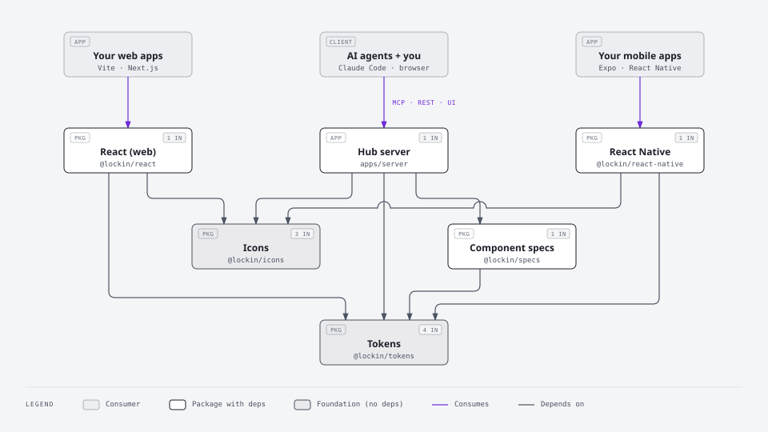
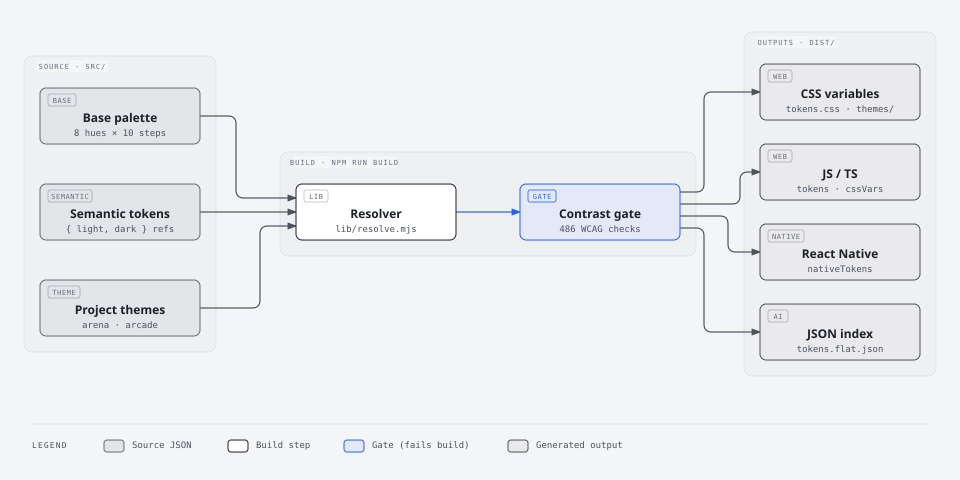
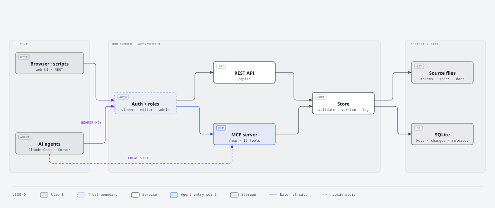
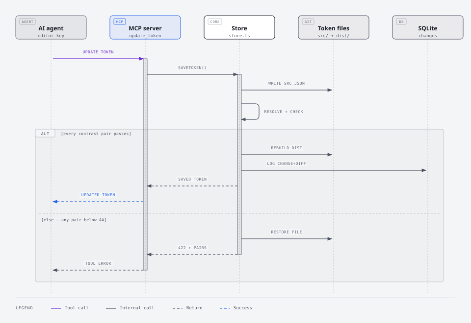

# Architecture

> How Lock In is put together: the packages and what depends on what, how tokens become platform code, how the hub server is structured, and what happens when someone edits the system.

Each diagram links to a full-size interactive version. Sources live in `docs/diagrams/` (`.html` is the source of truth; `.svg` is exported from it).

## Packages

[Open full size](./diagrams/package-map.html)

- **Tokens** is the foundation — four packages depend on it, so a token change flows everywhere at once.
- **Icons** is shared path data, rendered as inline SVG on web and with `react-native-svg` on mobile.
- **Component specs** describe every component's contract; the hub serves them to agents.
- Your apps only ever import `@lockin/react` or `@lockin/react-native` (plus the token CSS on web).

## Token pipeline

[Open full size](./diagrams/token-pipeline.html)

- Sources are DTCG JSON in `packages/tokens/src/`. Semantic colors carry `{ light, dark }` references into the base palette; themes swap the brand hue and override specific tokens.
- The **resolver** (`lib/resolve.mjs`) follows alias chains per mode and theme.
- The **contrast gate** fails the build if any pair in `contrast-pairs.json` drops below WCAG AA, in either mode, for any theme.
- Every output comes from the same resolved values, so web, native and AI agents always agree. Details: [Tokens](./tokens.md).

## Hub server

[Open full size](./diagrams/hub-architecture.html)

- **Two front doors, one store.** REST and MCP call the same store, so validation, versioning and contrast enforcement are identical for people and agents.
- **Auth** maps a bearer API key to a role (viewer / editor / admin). The local stdio MCP server skips key auth because it runs as you on your machine; its role comes from `DS_STDIO_ROLE`.
- **Content** (tokens, specs, docs) stays in plain files tracked by git. **Operational data** (API key hashes, change log, releases) lives in SQLite. Details: [MCP server & API](./mcp-server.md).

## Edit lifecycle

[Open full size](./diagrams/edit-lifecycle.html)

- The store writes the change, then re-resolves every token and re-runs every contrast check.
- **Pass:** outputs are rebuilt and the change is logged with who, why and a structural diff. Component edits also get an automatic semver bump.
- **Fail:** the original file is restored byte-for-byte and the caller gets a `422` listing exactly which pairs failed, so an agent can correct itself.
- Logged changes stay "unreleased" until an admin cuts a release, which snapshots the system and writes `CHANGELOG.md`.
