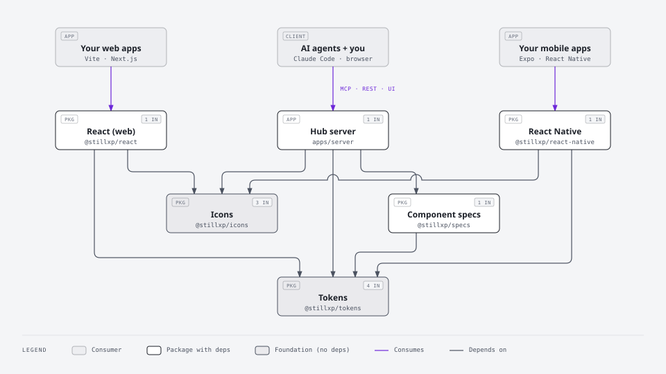

# Getting started

> Install Lock In in a web (React) or mobile (React Native / Expo) project, apply light/dark mode, and connect your AI agent.

Lock In ships as five packages:

| Package | What it is | Platforms |
| --- | --- | --- |
| `@stillxp/tokens` | Color, typography, spacing, radius, shadow, motion tokens. CSS variables, JS/TS objects, React Native values, JSON. | Web + native |
| `@stillxp/icons` | Icon path data (24×24 stroke icons). | Web + native |
| `@stillxp/react` | React components + one stylesheet. | Web |
| `@stillxp/react-native` | The same components for iOS/Android, same props wherever possible. | Native |
| `@stillxp/specs` | AI-readable JSON spec for every component. | Any |



More diagrams: [Architecture](./architecture.md).

## 1. Build the packages

From the design system repo:

```bash
npm install
npm run build        # tokens → icons → specs → react → react-native
```

The token build also runs the contrast checker; it fails if any semantic color pair drops below WCAG AA.

## 2. Use it in a project

The packages are published to GitHub Packages (private) as `@stillxp/*`. In your project, create a token with the `read:packages` scope and point the scope at the registry in `.npmrc`:

```
@stillxp:registry=https://npm.pkg.github.com
//npm.pkg.github.com/:_authToken=${GITHUB_TOKEN}
```

Then `npm install @stillxp/react @stillxp/tokens`. In another repo's CI, use a token that can read this repo's packages (a fine-grained PAT, or grant that repo access on each package's settings page).

To release: bump every `packages/*/package.json` to the same version, merge, then push a `vX.Y.Z` tag. `.github/workflows/release.yml` checks and builds, then publishes tokens, icons, specs, react and react-native in that order.

Trying an unreleased change in another project: `npm install ../path/to/design-system/packages/react`.

### Web (React: Vite, Next.js, etc.)

```tsx
// main.tsx — import tokens first, then component styles
import '@stillxp/tokens/css';
import '@stillxp/tokens/css/typography'; // optional .ds-text-* utility classes
import '@stillxp/react/styles.css';

import { Button, InputField, setColorMode } from '@stillxp/react';

export function JoinForm() {
  return (
    <form>
      <InputField label="Team name" required hint="3–24 characters" />
      <Button type="submit" variant="primary">Join tournament</Button>
    </form>
  );
}
```

`@stillxp/react` targets bundlers (Vite, Next.js, webpack, Metro). It's ESM with extensionless internal imports.

Fonts. `@stillxp/tokens/css` also loads Inter and JetBrains Mono (variable fonts bundled in the package), so there is no font setup. Your bundler needs to resolve `url()` assets in CSS, which Vite, Next.js and webpack do. See [Tokens](./tokens.md#fonts).

Color mode. Dark mode follows the OS by default (`prefers-color-scheme`). To let users choose:

```ts
setColorMode('dark');   // or 'light' | 'system' — saved to localStorage
```

To avoid a flash of the wrong theme, add this to `<head>` before your CSS:

```html
<script>
  try { const m = localStorage.getItem('ds-color-mode'); if (m === 'light' || m === 'dark') document.documentElement.dataset.theme = m; } catch {}
</script>
```

Styling your own UI. Use the CSS variables, never raw hex values:

```css
.scoreboard {
  background: var(--ds-color-surface-default);
  color: var(--ds-color-text-primary);
  padding: var(--ds-space-lg);
  border-radius: var(--ds-radius-lg);
  font: var(--ds-typography-heading-md);
}
```

In CSS-in-JS, use the `cssVars` export so values stay theme-aware: `import { cssVars } from '@stillxp/tokens'; cssVars.color.text.primary // "var(--ds-color-text-primary)"`.

### Mobile (React Native / Expo)

```bash
npx expo install react-native-svg
```

```tsx
import { ThemeProvider, Button, useTheme } from '@stillxp/react-native';

export default function App() {
  return (
    <ThemeProvider mode="system" /* theme="arena" */>
      <Home />
    </ThemeProvider>
  );
}

function Home() {
  const { t } = useTheme(); // resolved tokens for the active mode
  return (
    <View style={{ flex: 1, backgroundColor: t.color.background.default, padding: t.space.md }}>
      <Button onPress={startMatch}>Start match</Button>
    </View>
  );
}
```

Native tokens are plain numbers (`t.space.md === 16`) and RN-ready shadow objects (`...t.shadow.md`).

## 3. Connect your AI agent

The hub server exposes everything over MCP, which works with any MCP-capable agent (Claude Code, Cursor, VS Code, Codex, Gemini CLI, or your own). Agents without MCP can use the REST API and `/llms.txt`. [MCP server & API](./mcp-server.md#connect) has the config for each client. Working in this repo with Claude Code, the checked-in `.mcp.json` already registers `lockin` (check with `claude mcp list`).

In another project, add this to your client's MCP config (most use this `mcpServers` shape):

```json
{
  "mcpServers": {
    "lockin": { "command": "npx", "args": ["tsx", "C:/path/to/design-system/apps/server/src/stdio.ts"] }
  }
}
```

Agents then call `search_design_system`, `get_component`, `get_tokens` and `check_contrast` instead of guessing.

## Next

- [Tokens](./tokens.md): what each token is for
- [Components](./components.md): conventions shared by every component
- [Theming](./theming.md): re-skin per project without losing consistency
- [Accessibility](./accessibility.md): the rules every screen must meet
