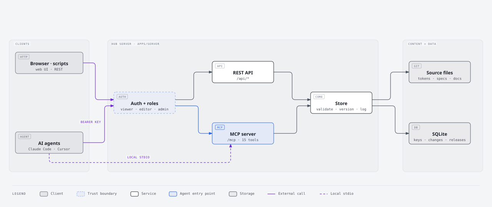
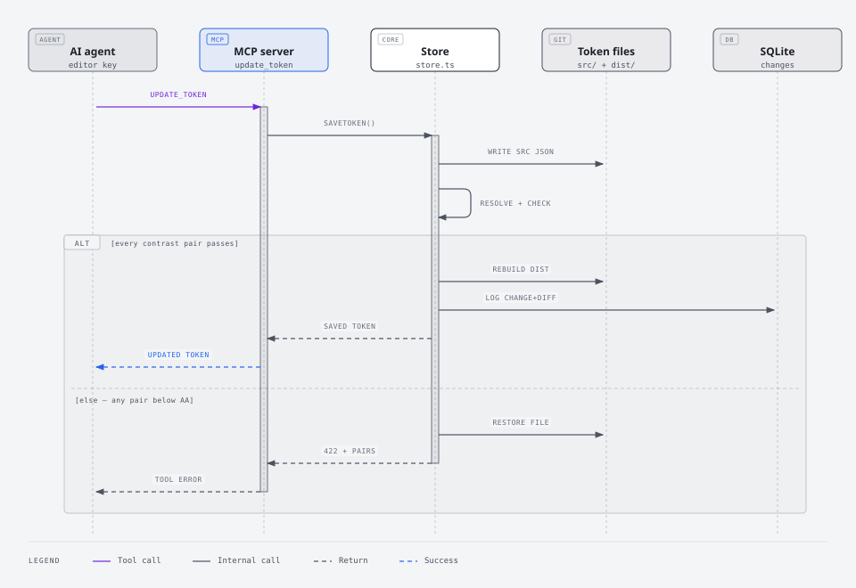

# MCP server & API (the hub)

> The hub serves tokens, components and docs to people (web UI), programs (REST) and AI agents (MCP), with API-key auth, versioning and change tracking.



[Open full size](./diagrams/hub-architecture.html)

## Run it

```bash
npm install && npm run build      # once
npm run dev                       # http://127.0.0.1:4400 (watches for changes)
```

On first start the server prints a bootstrap admin key. Save it. Anyone can browse without a key (public read is on by default); to edit, open Settings in the web UI and paste the key.

| URL | What |
| --- | --- |
| `/` | Web UI: browse/search tokens, components, proposals, docs, changes (no key needed); edit with an API key |
| `/api` | REST API (index of endpoints) |
| `/mcp` | MCP over Streamable HTTP (stateless) |
| `/llms.txt` | Plain-text guide for agents (public) |
| `/storybook` | Static Storybook build (from `npm run build`); component pages embed its stories as live examples |

Environment variables:

| Variable | Default | Meaning |
| --- | --- | --- |
| `PORT` / `HOST` | `4400` / `127.0.0.1` | Bind address. Keep `127.0.0.1` unless you put it behind HTTPS. |
| `DS_DATA_DIR` | `apps/server/data` | SQLite database (keys, changes, releases) |
| `DS_PUBLIC_READ` | `true` | Anonymous callers get the read-only `viewer` role (REST, MCP, web UI). Set `false` to require a key for everything. |
| `DS_STDIO_ROLE` | `editor` | Role for the local stdio MCP server |
| `DS_GITHUB_TOKEN` / `DS_GITHUB_REPO` | (unset) | Optional. When both are set, each submitted proposal also opens a GitHub issue in `owner/repo` (token needs issues: write). |

The server uses Node's built-in `node:sqlite` (Node ≥ 22.13). Node 22 prints an "ExperimentalWarning" for it; that's expected.

## Authentication & roles

Send a key as `Authorization: Bearer ds_…` (or `X-API-Key`). Keys are stored as SHA-256 hashes; the plaintext is shown once.

| Role | Can |
| --- | --- |
| `viewer` | Read everything (anonymous callers get this when public read is on) |
| `editor` | + edit tokens, components, docs; file proposals; MCP write tools |
| `admin` | + cut releases, create/revoke API keys |

Manage keys from the web UI (Settings, admin only), the API (`/api/keys`), or the CLI:

```bash
npm run keys -w @lockin/server -- create --name "coding-agent" --role viewer
npm run keys -w @lockin/server -- list
npm run keys -w @lockin/server -- revoke --id <id>
```

Read-only agents need no key while public read is on. Give agents that edit the lowest role that works, usually `editor`.

## REST API

| Method & path | Role | Notes |
| --- | --- | --- |
| `GET /api/overview` | viewer | Version, counts, unreleased change count |
| `GET /api/search?q=&types=component,token,doc,icon` | viewer | Ranked results |
| `GET /api/tokens?prefix=&type=&theme=` | viewer | Flat resolved tokens |
| `GET /api/tokens/:name` | viewer | One token + source + `usedBy` components |
| `PUT /api/tokens/:name` | editor | `{ value, description?, type?, layer?, summary? }`; rejected (422) if contrast breaks |
| `GET /api/themes` | viewer | Theme configs |
| `GET /api/contrast?fg=&bg=&mode=&theme=` | viewer | Token names or hex |
| `GET /api/components[?full=true]` | viewer | Summaries (name, status, version, category, `level`, purpose, import) or full specs |
| `GET /api/components/:name` | viewer | Full spec (name or slug) |
| `PUT /api/components/:slug` | editor | `{ spec, bump?, summary? }`; validated, auto-versioned |
| `GET /api/components/:name/history` | viewer | Change log with diffs |
| `GET /api/components/:name/stories` | viewer | Storybook stories (`id`, `name`) for the live example, found under `<Level>/<Name>` from the spec's level; `[]` if Storybook isn't built |
| `GET /api/icons?query=` | viewer | Icon names/keywords |
| `GET /api/proposals` | viewer | Proposal summaries (id, slug, title, kind, status, from, evidence count, links) |
| `GET /api/proposals/:id` | viewer | Full proposal by id (`LIP-001`), slug or component name |
| `GET /proposals/:id/prototype` | viewer | The proposal's prototype page (HTML), when it has a `proposals/page/<slug>.html` template |
| `POST /api/proposals` | editor | File a proposal: the intake fields plus `spec` for components. The hub assigns the id, status and submitter, validates, writes `proposals/<slug>.json`; 409 for duplicates, 422 if invalid |
| `POST /api/proposals/:id/evidence` | editor | `{ evidence: [{ product, where, link?, note? }] }`; skips entries already listed; 409 on released/declined |
| `GET /api/docs` · `GET /api/docs/:slug?format=html` | viewer | Docs |
| `PUT /api/docs/:slug` | editor | `{ content, summary? }` |
| `GET /api/changes?entityType=&entityId=&unreleased=true` | viewer | Audit trail |
| `GET /api/releases` · `GET /api/releases/:version` | viewer | Release list / full snapshot |
| `POST /api/releases` | admin | `{ bump?: major\|minor\|patch, version?, notes? }` |
| `GET/POST /api/keys` · `DELETE /api/keys/:id` | admin | Key management |

```bash
curl -H "Authorization: Bearer $DS_KEY" http://127.0.0.1:4400/api/components/button
```

## MCP

### Connect

Lock In is a standard MCP server, so any MCP client works: coding agents, IDE assistants, or your own agent built on an MCP SDK. There are two transports:

- **Local (stdio):** the agent runs on the same machine as a checkout of this repo. Command: `npx tsx <repo>/apps/server/src/stdio.ts` (role `editor` by default; set `DS_STDIO_ROLE=viewer` for read-only).
- **Remote (Streamable HTTP):** the agent talks to a running hub at `https://<hub>/mcp`. Put the hub behind HTTPS first. Reading needs no key while public read is on; editors send `Authorization: Bearer ds_…`.

Most clients take the common `mcpServers` JSON shape:

```json
{
  "mcpServers": {
    "lockin": { "command": "npx", "args": ["tsx", "<repo>/apps/server/src/stdio.ts"] },
    "lockin-remote": { "url": "https://ds.example.com/mcp", "headers": { "Authorization": "Bearer ds_…" } }
  }
}
```

Where that goes, for a few common clients (config formats change, so check your client's docs if one doesn't load):

| Client | Project config | Notes |
| --- | --- | --- |
| Claude Code | `.mcp.json` (this repo has one) | or `claude mcp add --transport http lockin https://ds.example.com/mcp --header "Authorization: Bearer ds_…"` |
| Cursor | `.cursor/mcp.json` | `mcpServers` shape above |
| VS Code (Copilot agent mode) | `.vscode/mcp.json` | top-level key is `servers`, and each entry has `"type": "stdio"` or `"type": "http"` |
| Codex CLI | `~/.codex/config.toml` | `[mcp_servers.lockin]` with `command = "npx"` and `args = ["tsx", "<repo>/apps/server/src/stdio.ts"]` |
| Gemini CLI | `.gemini/settings.json` | `mcpServers` shape above |
| No MCP support | — | use the [REST API](#rest-api) and `/llms.txt`; the playbooks are plain Markdown in `docs/` |

Only Claude Code's file is checked in, because this repo's maintainers use it. Add another client's file locally, or in a PR if more people use that client.

### Tools

| Tool | Role | Purpose |
| --- | --- | --- |
| `search_design_system` | viewer | Find components, tokens, docs, icons |
| `list_components` / `get_component` | viewer | Specs; the list includes each component's atomic level (atom, molecule, organism) |
| `get_tokens` / `get_token` | viewer | Resolved tokens (filter by prefix/type/layer/theme) |
| `check_contrast` | viewer | WCAG ratio for tokens or hex |
| `list_icons` | viewer | Icon names |
| `list_docs` / `get_doc` | viewer | Guides |
| `get_changelog` | viewer | Changes and releases |
| `list_proposals` / `get_proposal` | viewer | Lock In proposals (LIP) and their status; check before filing |
| `update_component` / `update_token` / `update_doc` | editor | Writes (validated, logged, versioned) |
| `submit_proposal` / `add_proposal_evidence` | editor | File a proposal or add evidence to an open one (see [Proposals](#proposals)) |

Resources: `ds://overview`, `ds://tokens/{light|dark}`, `ds://components/{slug}`, `ds://docs/{slug}`.
Prompts (any client that supports MCP prompts; the playbooks are also plain docs for clients that don't):

| Prompt | Arguments | What |
| --- | --- | --- |
| `build_with_lockin` | task, platform | Build UI with Lock In components and tokens |
| `propose_to_lockin` | need, from?, issue? | File a proposal: the [propose playbook](./propose.md) |
| `build_proposal` | id, part? (`all`, `code`, `figma`) | Build an accepted proposal: the [build playbook](./build-proposal.md) |

## Proposals

When Lock In has nothing that fits, agents file a **proposal (LIP)** instead of keeping a private workaround. The server instructions tell agents to do this (step 5). The full procedure is the [propose playbook](./propose.md) (MCP prompt `propose_to_lockin`); in short:

1. `list_proposals` / `search_design_system`. If a proposal already covers it, `add_proposal_evidence` with your product and screen.
2. Otherwise, `submit_proposal` with the problem, evidence (Figma or code links), the closest existing component and why it can't be extended, the stand-in, open questions and, for components, a draft spec (`status: "experimental"`, checked like any spec). Run `check_contrast` for new color pairings first.
3. The hub assigns the next `LIP-NNN`, sets `status: proposed`, writes `proposals/<slug>.json`, logs the change and, when `DS_GITHUB_TOKEN` and `DS_GITHUB_REPO` are set, opens the GitHub issue with the `proposal`, `status:proposed` and `kind:*` labels.

The file is written to the hub's working tree, and the issue embeds it: with GitHub configured, the Proposals workflow turns the issue into a PR, so nothing needs committing from the hub's machine. Without GitHub, commit the file with a PR yourself. Triage (accept or decline) stays with the design system owner. See `proposals/README.md` for the lifecycle, and the [build playbook](./build-proposal.md) for what happens after acceptance.

Prototype pages: a proposal with a `proposals/page/<slug>.html` template is served, built, at `/proposals/<slug>/prototype` (viewer role; `prototypePage` in the API response). The page runs in a sandboxed origin, so its scripts can't reach the hub's API or stored key.

## Versioning & change tracking



[Open full size](./diagrams/edit-lifecycle.html)

- Component versions (semver, in each spec) bump automatically on save:
  - major: a prop removed/renamed, a prop type changed, or an optional prop made required
  - minor: props, variants or states added
  - patch: anything else (docs, guidance, token mapping)
- Every write (token, component, doc) records who, when, why (`summary`), version from→to, and a structural diff.
- Releases (admin) bump `design-system.json`, snapshot every token and spec, mark pending changes as released, and prepend an entry to `CHANGELOG.md`.
- Source files are plain JSON/Markdown in git, so `git diff`/`git log` remain the long-term history. Commit after editing through the hub.

## Security notes

- Binds to localhost by default. To expose it, run behind a TLS reverse proxy (Caddy, nginx), because keys are bearer tokens and must not travel over plain HTTP.
- With public read on, everything readable (tokens, specs, docs, change history and releases) is visible to anyone who can reach the server. Writes, releases and key management always need a key.
- Docs markdown has raw HTML escaped when rendered; the web UI escapes all content it inserts.
- Responses set a strict Content-Security-Policy, `nosniff`, `DENY` framing and `no-referrer`. The exception is `/storybook`: Storybook needs inline scripts, and the hub frames it, so it gets a looser CSP and same-origin framing only. Like the other static assets, it's served without a key even when public read is off. The hub may also frame `embed.figma.com` / `www.figma.com` for the Design tab (view-only Figma embeds).
- The SQLite file in `DS_DATA_DIR` holds key hashes, change history and releases. It's git-ignored, so back it up separately.
